# What Does the Jones Polynomial Know About a Knot's Geometry?

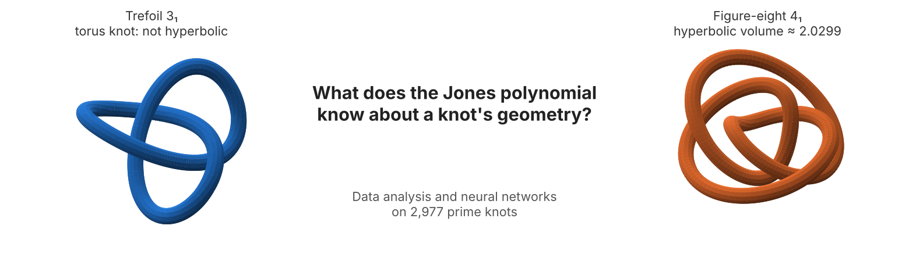

   

The Jones polynomial is a *quantum* invariant of knots: it comes from physics and representation theory, not from
the shape of the knot. Hyperbolic volume is a *geometric* invariant: the volume of the knot complement in its unique
hyperbolic structure. This project asks how much information about the second is contained in the first, using every
prime knot with 3 to 12 crossings in the [KnotInfo](https://knotinfo.math.indiana.edu) database.

It has two projects:

1. **[Knot invariant analysis](1_knot_invariant_analysis.ipynb):** check known theorems against the data, compare how
   well classical invariants predict volume, and test a published conjecture on every alternating knot.
2. **[Neural network for hyperbolic volume](2_neural_network_volume.ipynb):** train a neural network to predict volume
   from the Jones polynomial, then search for a simple formula that explains most of what the network learned.

## How the project fits together

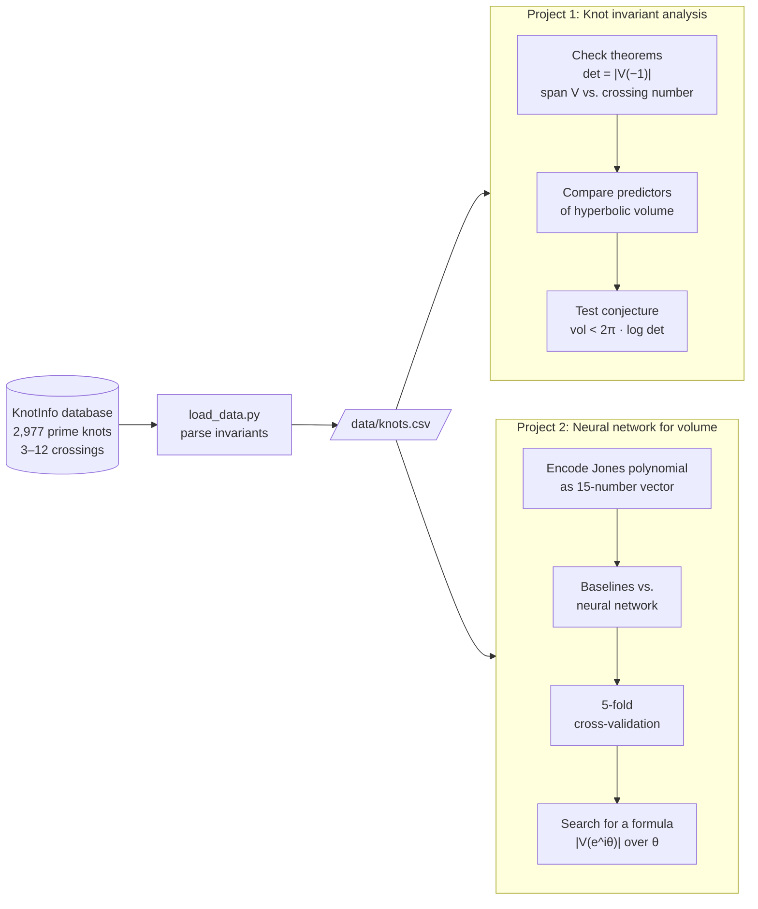

---

## Key results

| Result | Value |
|---|---|
| det(K) = \|V(−1)\| (consistency check on the data) | holds for 2,977 / 2,977 knots |
| span V = crossing number for alternating knots (Kauffman–Murasugi–Thistlethwaite) | 1,851 / 1,851 alternating; span < crossing number for 1,126 / 1,126 non-alternating |
| Correlation of volume with crossing number | r = 0.47 |
| Correlation of volume with log(det), alternating knots | r = 0.97 |
| vol(K) < 2π · log det(K) (Champanerkar–Kofman–Purcell conjecture) | holds for 1,846 / 1,846 alternating hyperbolic knots; closest is 12a_868 at 63% of the bound |
| **Neural network error predicting volume from the Jones polynomial** | **4.5%** mean relative error (5-fold cross-validation) |
| Linear regression on log(det), for comparison | 11.6% |
| Best one-number formula, volume ≈ a · log(\|V(e^(iθ))\| + 1) + b | **6.0%** at θ ≈ 0.79π (near 3π/4) vs. 11.2% at θ = π |

### Project 1: the Jones polynomial detects alternating knots

The span of the Jones polynomial equals the crossing number for every alternating knot and is strictly smaller for every
non-alternating knot, as the Kauffman–Murasugi–Thistlethwaite theorem predicts.

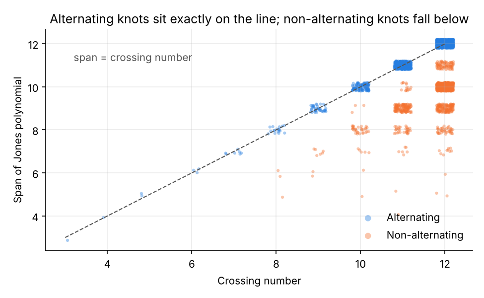

The determinant, which is one value of the Jones polynomial, predicts volume much better than crossing number, and every
alternating knot satisfies the conjectured bound vol < 2π log det.

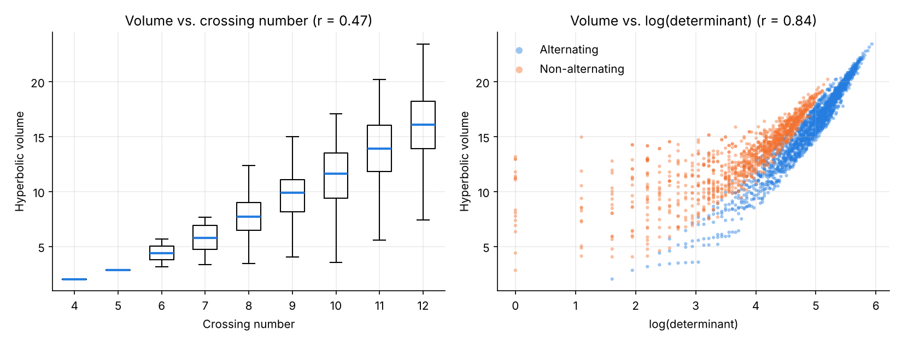
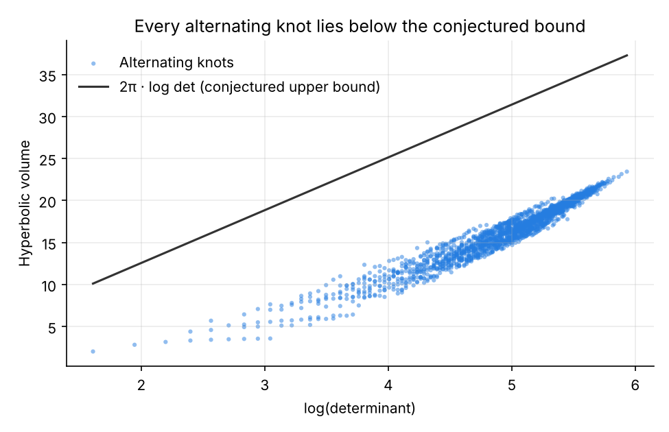

### Project 2: a neural network learns volume, and one number explains most of it

A network with two hidden layers of 100 neurons predicts volume with 4.5% average error on knots it never saw in
training, compared with 11.6% for the best linear baseline. It works on non-alternating knots too (5.1% error vs. 4.2%
for alternating).

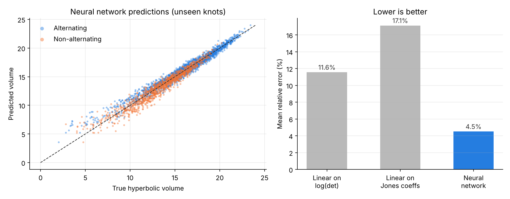

To look inside the black box, we evaluate the Jones polynomial at points t = e^(iθ) on the unit circle and fit a
one-variable formula for each θ. The error is lowest near θ ≈ 0.79π, close to the value 3π/4 that Craven, Jejjala and
Kar (2021) extracted from a trained network, and roughly half the error at θ = π (the determinant).

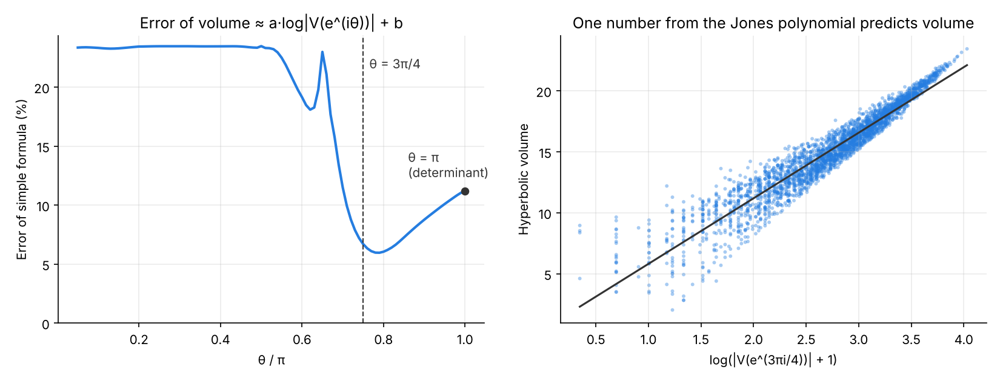

With about 10% of the knots (≈300) for training, the network already beats the best linear baseline.

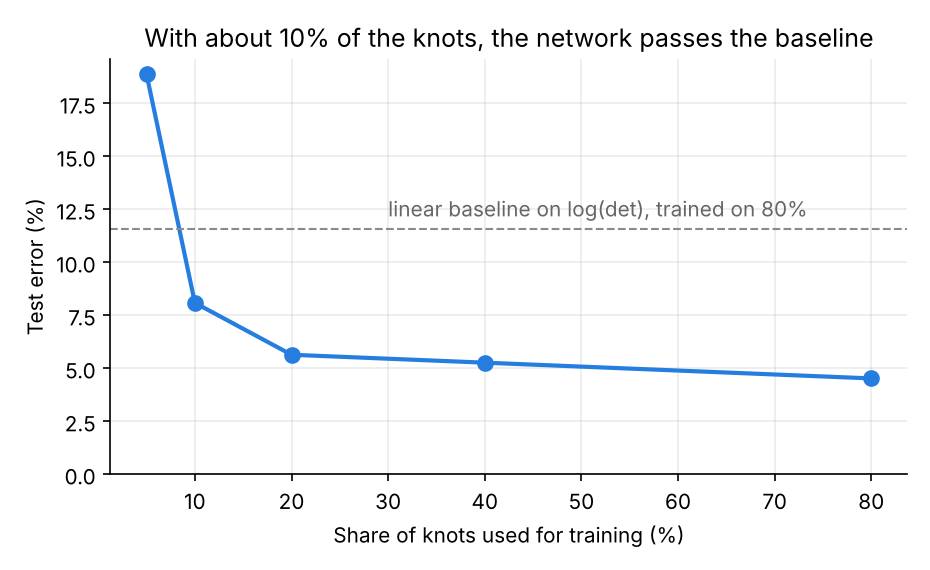

---

## Repository structure

```
knot-ml/
├── 1_knot_invariant_analysis.ipynb   Project 1: theorems, volume predictors, conjecture test
├── 2_neural_network_volume.ipynb     Project 2: neural network, learning curve, formula search
├── load_data.py                      Builds data/knots.csv from the KnotInfo database
├── data/                             Generated data (not tracked; run load_data.py)
├── figures/                          Plots produced by the notebooks, plus the banner
├── docs/methods.md                   Background and methods in more detail
├── CITATION.cff                      How to cite this project
├── requirements.txt
└── LICENSE
```

## How to reproduce

Requires Python 3.10 or newer.

```bash
git clone https://github.com/<your-username>/knot-ml.git
cd knot-ml
pip install -r requirements.txt
python load_data.py          # no download needed: KnotInfo data ships with the database_knotinfo package
jupyter notebook             # open each notebook and choose Run All
```

Both notebooks run in under a minute on a laptop. All random seeds are fixed, so the numbers above should reproduce exactly
with the package versions in `requirements.txt` (small differences are possible with other versions of scikit-learn).

## Methods in brief

**Data.** All 2,977 prime knots with 3–12 crossings that have Jones polynomial data in KnotInfo; 2,970 are hyperbolic.

**Turning a polynomial into model input.** Each Jones polynomial becomes a fixed-length vector:

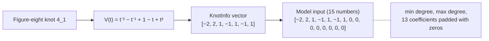

**The neural network.** scikit-learn `MLPRegressor`, with early stopping to prevent overfitting:

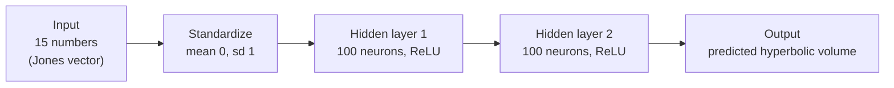

**Evaluation.** Mean relative error |predicted − true| / true, measured with 5-fold cross-validation:

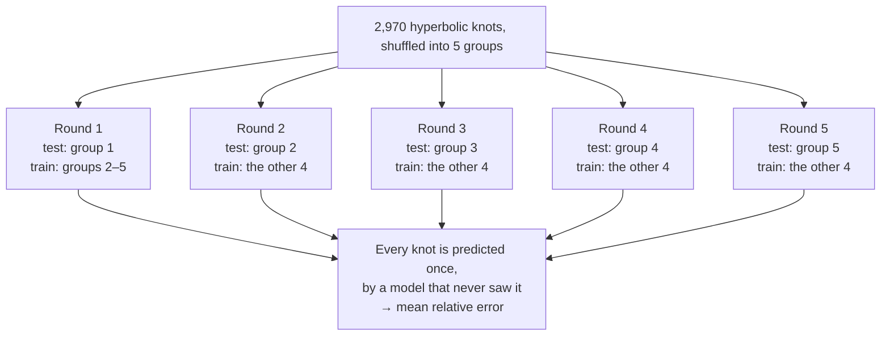

See [docs/methods.md](docs/methods.md) for the mathematical background and full details.

## Limitations

- Only knots with up to 12 crossings (about 3,000 knots); published studies use far larger knot tables.
- The formula search tries a single family of one-variable linear models, so better formulas may exist.
- Testing a conjecture on examples is evidence, not proof.

## Possible next steps

- Does the best evaluation angle drift as crossing number grows?
- Train on knots up to 11 crossings and test on 12-crossing knots, to measure generalization to larger knots.
- Replace the Jones polynomial with colored Jones polynomials, which appear in the volume conjecture.

## References

- C. Livingston and A. H. Moore, *KnotInfo: Table of Knot Invariants*, [knotinfo.math.indiana.edu](https://knotinfo.math.indiana.edu)
- L. H. Kauffman, *State models and the Jones polynomial*, Topology 26 (1987)
- K. Murasugi, *Jones polynomials and classical conjectures in knot theory*, Topology 26 (1987)
- A. Champanerkar, I. Kofman, J. Purcell, *Geometrically and diagrammatically maximal knots*, J. London Math. Soc. (2016)
- V. Jejjala, A. Kar, O. Parrikar, *Deep learning the hyperbolic volume of a knot*, Physics Letters B 799 (2019)
- J. Craven, V. Jejjala, A. Kar, *Disentangling a deep learned volume formula*, JHEP (2021)
- C. Adams, *The Knot Book*, American Mathematical Society

## Author

**Sher Baz Riasat**, Computer Science and Applied Mathematics, Texas State University

## Acknowledgments

Knot data from KnotInfo, accessed through the `database_knotinfo` Python package. Built with assistance from Claude (an AI
assistant); I ran, checked and can explain every result.

Code released under the [MIT License](LICENSE).
