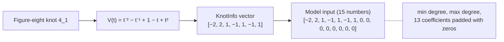
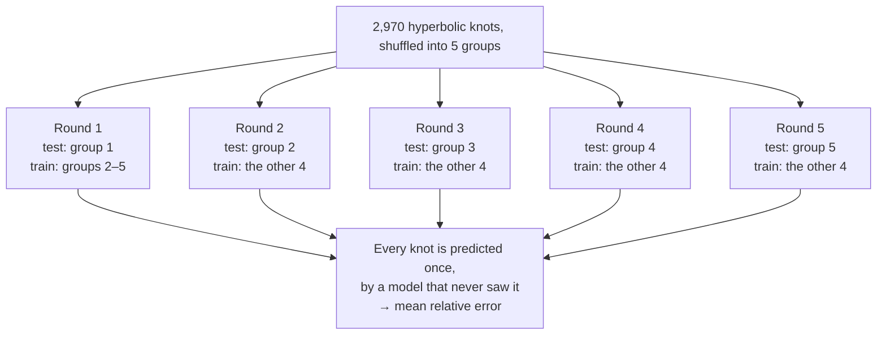
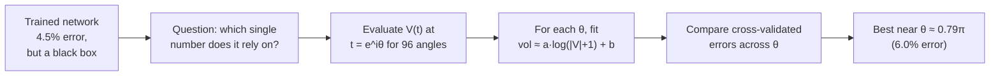

# Background and Methods

## 1. Mathematical background

### Knots and invariants
A **knot** is a closed loop in 3-dimensional space, considered up to continuous deformation without cutting.
A **knot invariant** is a quantity that is the same for any two diagrams of the same knot. Invariants are how we tell
knots apart.

Invariants used here:

| Invariant | Meaning |
|---|---|
| **Crossing number** c(K) | The fewest crossings in any diagram of the knot. |
| **Alternating** | The knot has a diagram whose crossings alternate over, under, over, under along the strand. |
| **Determinant** det(K) | A classical integer invariant; det(K) = \|V(−1)\|. |
| **Jones polynomial** V(t) | A Laurent polynomial in t, discovered by Vaughan Jones in 1984 from operator algebras. It can be computed from a diagram using the Kauffman bracket. |
| **Hyperbolic volume** vol(K) | Most knots are *hyperbolic*: the space around the knot carries a unique geometry of constant negative curvature. Its volume is a topological invariant. |

### Why relate the Jones polynomial to volume?
The Jones polynomial is defined combinatorially, with no reference to geometry, yet there are deep conjectured links
between the two. The **volume conjecture** (Kashaev; H. Murakami and J. Murakami) states that the *colored* Jones
polynomials, evaluated at roots of unity, determine the hyperbolic volume in a limit. This project explores a
simpler, data-driven version of that question using only the ordinary Jones polynomial.

### Results tested in Project 1
- **det(K) = |V(−1)|** for every knot. Used as a check that the data was parsed correctly.
- **Kauffman–Murasugi–Thistlethwaite theorem (1987).** The span of V (maximum degree minus minimum degree) equals the
  crossing number of a reduced alternating diagram, and is strictly less than the crossing number for a non-alternating
  prime knot. This proved one of Tait's 19th-century conjectures.
- **Champanerkar–Kofman–Purcell conjecture.** For every alternating hyperbolic knot, vol(K) < 2π · log det(K).
  Checking examples gives evidence for a conjecture but does not prove it.

## 2. Data

- **Source:** the KnotInfo database (Livingston and Moore), through the `database_knotinfo` Python package.
- **Selection:** all prime knots with 3 to 12 crossings that have Jones polynomial data: 2,977 knots
  (1,851 alternating, 1,126 non-alternating). Of these, 2,970 are hyperbolic; the remaining 7 (torus knots such as 3_1)
  have no hyperbolic volume and are excluded from Project 2.
- **Jones polynomial format:** KnotInfo stores V(t) as `[min_degree, max_degree, c0, c1, ...]`. For example the
  figure-eight knot 4_1 is `[-2, 2, 1, -1, 1, -1, 1]`, meaning V(t) = t⁻² − t⁻¹ + 1 − t + t².
- **Conventions:** KnotInfo fixes one choice of mirror image for each knot. Volume and determinant do not depend on this
  choice; the Jones polynomial of the mirror image is V(1/t).

`load_data.py` produces `data/knots.csv` with one row per knot.

## 3. Methods for Project 2

### Input encoding

Models need fixed-length inputs, so each Jones polynomial becomes a 15-number vector:
`[min_degree, max_degree, c0, c1, ..., c12]`, with coefficients padded by zeros to length 13 (the longest polynomial
in the data).

### Models
| Model | Input | Purpose |
|---|---|---|
| Linear regression | log(det) | Best single predictor from Project 1; the main baseline |
| Linear regression | 15-number Jones vector | Same information as the network, but only straight-line relationships |
| Neural network (multilayer perceptron) | 15-number Jones vector | Can learn non-linear relationships |

The neural network is scikit-learn's `MLPRegressor` with two hidden layers of 100 neurons (ReLU activation, Adam
optimizer), the architecture size used by Jejjala, Kar and Parrikar (2019). Inputs are standardized to mean 0 and
standard deviation 1. Early stopping holds out 10% of the training data and stops when the error on it stops improving.

### Evaluation

- **Metric:** mean relative error, the average of |predicted − true| / true.
- **5-fold cross-validation:** the knots are shuffled and split into 5 groups. Each model is trained on 4 groups and
  tested on the 5th, rotating so every knot is tested once by a model that never saw it. This measures how well a model
  generalizes, not how well it memorizes.
- **Learning curve:** the network is trained on 5%, 10%, 20%, 40% and 80% of the knots and tested on the rest, with three
  random splits per size.

### Formula search

For 96 angles θ between 0.05π and π, we compute |V(e^(iθ))| for every knot and fit

    volume ≈ a · log(|V(e^(iθ))| + 1) + b

by linear regression, recording the cross-validated error. The "+1" avoids taking log(0). At θ = π this reduces to a
formula in the determinant. Near θ = 0 the formula carries no information, since V(1) = 1 for every knot.

## 4. Reproducibility

All random seeds are fixed (`random_state=0` for the cross-validation split and the network; seeds 0–2 for the
learning curve). Results were produced with Python 3.13, NumPy 2.5, pandas 3.0, scikit-learn 1.9 and
database_knotinfo 2026.11.2.
